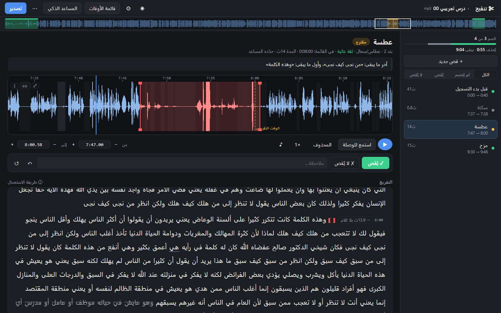

# تنقيح

يحذف «تنقيح» من التسجيلات الصوتية الطويلة (الدروس والمجالس) ما ليس منها: المزاح والكلام الجانبي والعطاس والسكتات الطويلة ومشكلات البث. يبدأ من **أوقات تقريبية يكتبها المراجعون**، فيجد كل موضع في الصوت ويقترح حدوده بدقة. ثم **تراجع أنت كل قصّة بأذنك** قبل أن يُكتب الملف المنقّح.



## ما يفعله

- يقبل قائمة الأوقات بالصيغ المعتادة، ومنها الأوقات المكتوبة من العدّ التنازلي.
- يحلّل الصوت ويفرّغ ما حول كل وقت تفريغًا آليًّا. كل ذلك على جهازك، ولا يُرفع التسجيل إلى أي مكان.
- يقترح الحدود آليًّا بلا ذكاء اصطناعي: يلصقها بالسكتات، ويجد العطسة قرب الوقت المذكور، ويختار أطول سكتة.
- **المساعد الذكي (اختياري)**: ينسخ لك نصًّا جاهزًا تلصقه في أي مساعد محادثة (ChatGPT أو Claude أو Gemini أو غيرها)، ثم تلصق رده فتُطبَّق مقترحاته. لا يحتاج مفتاحًا ولا اشتراكًا معيّنًا.
- واجهة مراجعة فيها موجة الصوت والتفريغ، والاستماع إلى الوصلة كما ستُسمع بعد القص، وتعديل الحدّين بالفأرة أو بلوحة المفاتيح.
- يقص بدقة العيّنة الواحدة مع تلاشٍ قصير عند كل وصلة، ويكتب سجلًّا بالقصّات وخريطة للأوقات (القديم ← الجديد).
- يعمل على ويندوز وماك.

## التثبيت والتشغيل

لا يلزمك تثبيت Python ولا ffmpeg، فالبرنامج ينزّل ما يحتاجه في أول تشغيل.

1. نزّل البرنامج: من صفحة المستودع على GitHub اضغط **Code ← Download ZIP** وفكّ الضغط في مكان ثابت. أو بـ git:
   ```
   git clone https://github.com/<user>/tanqih.git
   ```
2. شغّله:
   - **ويندوز**: انقر نقرًا مزدوجًا على `start-windows.bat`.
   - **ماك**: انقر نقرًا مزدوجًا على `start-mac.command`. إذا منعه النظام في المرة الأولى فانقر عليه بالزر الأيمن ثم **Open**. أو افتح Terminal في المجلد واكتب `bash start-mac.command`.
3. التشغيل الأول ينزّل Python والمكتبات (بضع دقائق). وأول تفريغ ينزّل نموذج التفريغ (نحو 1.6 GB). وبعدها يعمل البرنامج دون إنترنت، إلا المساعد الذكي إن استعملته.
4. تُفتح الواجهة في المتصفح. اترك النافذة السوداء مفتوحة أثناء العمل، وأغلقها لإيقاف البرنامج.

**المتطلبات**: ويندوز 10 أو 11 (64 بت)، أو ماك: Apple Silicon بنظام macOS 14 أو أحدث، أو Intel بنظام macOS 11 أو أحدث. ونحو 4 GB مساحة فارغة للبرنامج والنموذج، وقرابة 450 MB لكل أربع ساعات من التسجيل أثناء العمل عليه.

## طريقة العمل

1. **أضف مجلدًا** فيه التسجيلات. تظهر ملفاته في الصفحة الرئيسية مع حالة كل ملف.
2. **أضف قائمة الأوقات** لكل ملف: زر «القائمة» ثم الصق قائمة المراجِع. يظهر بجوارها جدول يبيّن كيف فُهم كل سطر. وأسهل من ذلك أن تضع القائمة في ملف نصي **بنفس اسم التسجيل** بجواره (`درس 05.txt` بجوار `درس 05.mp3`)، فيقرؤها البرنامج تلقائيًّا.
3. **جهّز**: يستخرج البرنامج الصوت، ويحلل السكتات، ويفرّغ ما حول كل وقت في القائمة. ويمكن وضع عدة ملفات في قائمة الانتظار («جهّز كل ما له قائمة») ومراجعة ما انتهى منها.
4. **اختياري: المساعد الذكي.** انظر القسم التالي.
5. **راجع**: لكل بند استمع للوصلة (`P`)، وعدّل الحدّين إن لزم، ثم اختر «يُقص» (`Enter`) أو «لا يُقص» (`K`). ويمكنك إضافة قصّات لم ترد في القائمة.
6. **صدّر**: يُكتب الملف المنقّح في مجلد `منقح` بجوار الأصل، ومعه سجل القص. ولا يُمسّ الملف الأصلي.

## صيغة قائمة الأوقات

كل سطر فيه وقت أو وقتان يصير بندًا، وباقي السطر هو الوصف. والأسطر التي بلا أوقات (العناوين وأسماء المراجعين) تُتجاهل.

```
0:08:00 عطسة
1:00:50 - 1:01:30 رد السلام
من 1:10:00 إلى 1:12:30 مزح
3) 25:40 – 26:10 كلام جانبي
١:٠٥:٣٠ سعال
البداية - 0:00:40 قبل بدء الدرس
1:30:00 - النهاية   نهاية الدرس
1:02:10 مزح (متبقي)
1:20:00 - 1:24:00 فائدة طويلة، يراجع
```

- **الوقت الواحد** يعني «في هذا الموضع شيء»، والبرنامج أو المساعد يحدّد مداه.
- **الوقت المتبقي**: إذا كتب المراجِع الوقت من العدّ التنازلي في المشغّل فاكتب في السطر «متبقي» أو «معكوس»، أو علّم خيار «الأوقات كلها من الوقت المتبقي». ويُحوَّل الوقت بمدة الملف الحقيقية.
- **الوقت ذو الجزأين** مثل `12:30` يُفهم دقائق:ثواني. وإن كان المراجِع يقصد ساعات:دقائق فغيّر الخيار تحت القائمة.
- **التصنيف** يُستنتج من الوصف: مزح، كلام جانبي، عطاس/سعال، سكتة، بث/أجهزة، تكرار، غير مسموع، أذان… وكلمات مثل «فائدة» أو «وعظ» أو «سؤال» أو «يراجع» تجعل البند «يحتاج قرارك» بدل أن يُقترح قصّه مباشرة.

أوقات المراجعين يكفي أن تكون تقريبية. فالبرنامج يبحث حول كل وقت دقيقتين ونصفًا من كل جهة، ويمكن تغيير ذلك من الإعدادات.

## المساعد الذكي

البرنامج يحدّد الحدود الآلية من الصوت وحده. أما المواضع التي تحتاج فهم الكلام (أين بدأ المزاح؟ هل أعاد القارئ الجملة بعد المقاطعة؟) فيحسنها مساعد ذكي يقرأ التفريغ:

1. في صفحة الملف اضغط **المساعد الذكي**.
2. اضغط **نسخ** والصق النص في محادثة جديدة مع أي مساعد. النص فيه التعليمات وتفريغ ما حول كل بند، مع أوقاته وسكتاته والأصوات المرتفعة فيه.
3. انسخ رد المساعد كاملًا والصقه في الخانة المقابلة، ثم اضغط **طبّق الرد**.
4. تصير البنود «مقترحة» ومعها سبب كل اقتراح، وتبقى مراجعتها بأذنك واجبة.

إذا كان الملف طويلًا قُسّم النص دفعات، فأرسل كل دفعة والصق الردود كلها. ولا يُرسَل إلى المساعد إلا نص التفريغ، لا الصوت. والبنود التي عدّلتها بنفسك لا يغيّرها المساعد إلا إذا اخترت ذلك.

**وكلاء البرمجة**: من يستعمل Claude Code أو Codex أو Gemini CLI يستطيع أن يفتح مجلد البرنامج ويطلب من الوكيل مراجعة ملف. التعليمات في [AGENTS.md](AGENTS.md).

## الإعدادات

من زر ⚙ أعلى الصفحة:

| الإعداد | ملاحظة |
|---|---|
| لغة التسجيلات | العربية افتراضيًّا |
| نموذج التفريغ | `large-v3-turbo` هو الأدق، ويفرّغ نحو ساعتين من الصوت في ساعة على معالج حديث. `small` أسرع بكثير وأقل دقة، وهو للأجهزة الضعيفة |
| نطاق البحث | كم ثانية يُفرَّغ حول كل وقت (150 افتراضيًّا) |
| صيغة الإخراج | مثل الأصل، أو M4A أو MP3 أو OGG أو FLAC أو WAV. وفي «مثل الأصل» لا يتجاوز معدل البت معدل الأصل |
| مجلد الإخراج | فارغ = مجلد `منقح` بجوار كل تسجيل |

## أين تُحفظ الملفات؟

- **ملفات العمل** (نسخة التحليل، والتفريغ، وقراراتك) في مجلد مخفي اسمه `.tanqih` بجوار التسجيلات. تُحفظ القرارات تلقائيًّا مع نسخ احتياطية. ويمكن حذف هذا المجلد بعد الانتهاء لتوفير المساحة.
- **النتائج** في مجلد `منقح`.
- **قائمة المجلدات والإعدادات** في `%APPDATA%\Tanqih` على ويندوز، و`~/Library/Application Support/Tanqih` على ماك.

## حل المشكلات

- **ماك يقول إن الملف من مطوّر غير معروف**: انقر بالزر الأيمن على `start-mac.command` ثم Open. أو شغّله من Terminal: `bash start-mac.command`.
- **نافذة اختيار المجلد لا تظهر**: قد تكون خلف المتصفح. أو الصق مسار المجلد في الخانة.
- **التفريغ بطيء**: اختر نموذج `small` من الإعدادات. وقلّل «نطاق البحث» إذا كانت أوقات المراجعين دقيقة.
- **نافذة بلا تفريغ**: في صفحة البند زر «فرّغ هذه النافذة». وإذا رأيت فجوة طويلة «النشاط الصوتي» فيها مرتفع، فقد يكون التفريغ أسقط كلامًا فيها، فاستمع إليها.
- **البرنامج يعمل من قبل**: تشغيله مرة ثانية يفتح الواجهة نفسها في المتصفح.

## للمطوّرين

```
uv run python -m tanqih            # الواجهة
uv run python -m tanqih --help     # أوامر سطر الأوامر
uv run python -m unittest discover tests
```

البرنامج Python وحده مع واجهة HTML بلا إطار، والتفريغ بـ [faster-whisper](https://github.com/SYSTRAN/faster-whisper). أهم الملفات:

| الملف | ما فيه |
|---|---|
| `tanqih/cutlist.py` | قراءة قوائم الأوقات |
| `tanqih/items.py` | تحويل القائمة إلى بنود والاقتراح الآلي |
| `tanqih/assist.py` | نص المساعد الذكي وقراءة رده |
| `tanqih/transcribe.py` | التفريغ |
| `tanqih/render.py` | الإخراج |
| `tanqih/server.py` | الخادم المحلي وقائمة الأعمال |
| `tanqih/ui/` | الواجهة |

## الترخيص

[MIT](LICENSE)
